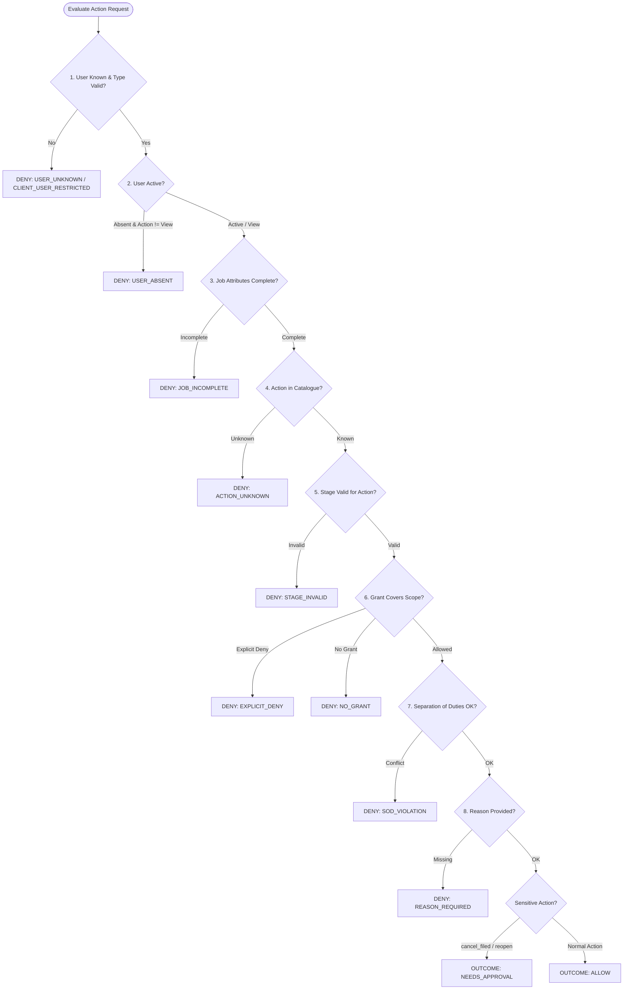

# System Design & Architecture Document: Nagarkot Access Control Service

## 1. Domain Context & The Core Problem
Nagarkot Forwarders Pvt. Ltd. is a licensed customs brokerage company operating across 5 Indian branches (Mumbai-Fort, Nhava Sheva, Delhi-ICD, Chennai, Kolkata) handling approximately 120 staff members and thousands of import/export shipments annually.

The service addresses an acute vulnerability: a filed shipment was altered by someone who had no business touching it. In international customs brokerage, an unverified alteration on a filed shipping bill or bill of entry triggers punitive regulatory penalties, cargo blacklisting, and revocation of customs brokerage licenses under the Indian Customs Act. 

The mandate of this service is simple, robust, and absolute: **decide who may do what on which job (shipment), enforce separation of duties, maintain an immutable audit trail, and guarantee zero-trust fail-closed security.**

---

## 2. Core Architecture & Data Model

### 2.1 The Multidimensional Job Entity
A job represents a discrete cargo shipment progressing through regulatory milestones:
$$\text{Job} = (\text{client\_id}, \text{branch\_id}, \text{direction}, \text{mode}, \text{stage}, \text{cycle})$$
- **Direction**: `IMPORT` or `EXPORT`
- **Mode**: `AIR`, `FCL` (Full Container Load), `LCL` (Less than Container Load)
- **Lifecycle Stages**: `CONFIRMED` $\to$ `PREPARED` $\to$ `CHECKED` $\to$ `FILED`
- **Terminal & Exceptional Stages**: `CANCELLED`, `REOPENED`
- **Cycle**: Integer incremented upon reopening to isolate operational accountability across iterations.

### 2.2 Roles as Data vs Code
Permissions form a fixed, immutable catalogue defined in code (`app/permissions.py`) because code dictates execution logic. Roles, however, are **data** (`roles` and `role_permissions` tables). Each role permission mapping carries temporal attributes (`added_at`, `removed_at`), allowing new operational roles to be defined and modified at runtime without software redeployment while retaining total fidelity for historical queries.

### 2.3 Explicit Grants & Scope Matching
Authorization is represented through `Grant` rows:
$$\text{Grant} = (U, R, C, B, D, M, \text{effect}, \text{valid\_from}, \text{valid\_to}, \text{revoked\_at})$$
Where $C, B, D, M$ represent dimensional filters. A `NULL` value denotes a universal wildcard (`ALL`). 
- **Precedence Rule**: Explicit `DENY` grants unconditionally override `ALLOW` grants.
- **Grant Immutability**: Grants are append-only. A grant is never deleted; revocation sets `revoked_at` and `revoked_by`.

---

## 3. The 8-Stage Decision Engine Pipeline

Every API action invokes the deterministic decision engine `decide(user_id, action, job, at=now)`. The pipeline evaluates all checks to capture a full audit trace, then determines the outcome based on strict precedence:



### Precedence Hierarchy:
1. `USER_KNOWN`: Unknown user ID or incompatible user type (e.g. client user attempting operational actions).
2. `USER_ACTIVE`: Absent staff cannot act (operational rights suspended; read view preserved).
3. `JOB_DATA_COMPLETE`: Missing dimensional attributes or malformed stages fail closed.
4. `ACTION_KNOWN`: Action must exist in permission catalogue.
5. `STAGE_VALID`: Enforces workflow state transitions.
6. `GRANT_COVERS_SCOPE`: Evaluates temporal grants, wildcards, and explicit deny overrides.
7. `SOD_OK`: Four-eyes checks (Maker $\neq$ Checker, Requester $\neq$ Approver).
8. `REASON_PROVIDED`: Mandatory descriptive reason for override and sensitive actions.

---

## 4. Answers to the 14 Standard Design Questions

### Q1: Should everyone see everything? Who sees what vs who may act?
**Answer**: Absolutely not. We separate visibility (`job.view`) from operational agency (`job.prepare`, `job.check`, `job.file`). Visibility is enforced at the database layer via `compile_jobs_view_predicate()` in SQL:
- Staff members only see shipments matching their active `job.view` grants.
- Client users are strictly isolated to shipments matching their assigned `client_id`, with all internal operational data (internal notes, assigned personnel, preparers, checkers, filers) redacted from JSON responses.
- Acting requires both visibility and an active operational grant matching the shipment's 4-dimensional scope.

### Q2: How to describe someone who is Maker for every client but Checker for only a few? Someone who is Checker for one client at one branch, imports only?
**Answer**: Through composable, dimensional `Grant` records:
- **Asha Rao** (Maker everywhere, Checker for C03, C05, C07):
  - Row 1: `user_id="asha-rao"`, `role="maker"`, scope: `(client=NULL, branch=NULL, dir=NULL, mode=NULL)` [Wildcard].
  - Rows 2–4: `user_id="asha-rao"`, `role="checker"`, scope: `client="C03"`, `client="C05"`, `client="C07"`.
- **Rohit Mehta** (Checker for C01, Mumbai-Fort, Imports only):
  - Row 1: `user_id="rohit-mehta"`, `role="checker"`, scope: `(client="C01", branch="BR-MUM", direction="IMPORT", mode=NULL)`.
  Any action attempted outside this exact tuple (e.g. exports or other branches) fails with `NO_GRANT`.

### Q3: Person who prepared a checklist is also qualified to approve it?
**Answer**: Qualification does not equate to permission on a specific job. While a senior officer may hold both `Maker` and `Checker` roles (e.g., Karan Shah at Chennai), the system enforces runtime **Separation of Duties (SoD)** per job cycle:
$$\text{Check Check: } \text{job.prepared\_by} \neq \text{caller.id}$$
If the same user prepared the shipment in the current cycle, `decide()` returns `SOD_VIOLATION_MAKER_CHECKER`. The four-eyes principle is non-negotiable.

### Q4: Person responsible for a job is absent?
**Answer**:
1. Marking a user absent (`PATCH /users/{id}/status` $\to$ `absent`) immediately suspends their operational rights (`USER_ACTIVE` check fails).
2. The user's assigned in-flight jobs are automatically unassigned and returned to the branch pool via `auto_unassign_ineligible_jobs()`.
3. Coverage is handled via time-bounded grants specifying `cover_for_user_id` and `valid_to` (e.g., Pooja Sharma holds a 7-day cover grant as Maker for Delhi-ICD covering Imran Shaikh). Once `valid_to` passes, access expires automatically without manual intervention.

### Q5: Jobs a person is halfway through when their responsibilities change?
**Answer**:
When an operational grant is revoked, `revoke_grant()` executes an atomic database inspection:
- It scans all in-flight jobs (`CONFIRMED`, `PREPARED`, `CHECKED`, `REOPENED`) assigned to that user.
- It tests if the user still holds valid permission for the job's next required action.
- If not, it sets `job.assigned_to = NULL`, writes an `AUTO_UNASSIGNED` audit record with before/after snapshots, and returns the shipment to the branch queue. History is preserved; the shipment is never stranded.

### Q6: Who can cancel a filed job or reopen a closed one, and what should it take?
**Answer**:
Once a job is `FILED`, ordinary staff cannot alter it. Sensitive actions (`cancel_filed`, `reopen`) mandate a **two-person rule**:
1. An authorized staff member with `job.cancel_filed` or `job.reopen` submits an action with a mandatory reason.
2. The decision engine returns `outcome = "NEEDS_APPROVAL"` and creates an `Approval` record with status `pending`.
3. An `Approver` holding `job.approve_sensitive` reviews the request.
4. The system validates:
   - $\text{approver.id} \neq \text{requested\_by}$ (self-approval prohibited).
   - The job stage has not changed concurrently (fail-closed stale check).
5. Upon approval, reopening increments the `cycle` counter and clears previous cycle handlers (`prepared_by`, `checked_by`, `filed_by`).

### Q7: A client's own employee needs to follow their shipments?
**Answer**:
Client users are first-class directory entities with `type = "client"` and mandatory `client_id`:
- Assigned the `Client Viewer` role (`job.view`).
- Restricted at the engine level: `USER_KNOWN` immediately rejects any non-view action with `CLIENT_USER_RESTRICTED`.
- Restricted at the database query level: `compile_jobs_view_predicate()` appends `Job.client_id == user.client_id`.
- Internal fields (`internal_notes`, `assigned_to`, `prepared_by`, `checked_by`, `filed_by`) are completely redacted in serialization.

### Q8: Admin needs to fix a stuck job? Admin tries to make themselves more powerful?
**Answer**:
- **Fixing a stuck job**: Ops Admin holds `job.override`, allowing `override_send_back` (rolling a job back from `PREPARED` to `CONFIRMED` or `CHECKED` to `PREPARED`) or reassignment. This requires a mandatory descriptive reason and is permanently flagged `is_override = true` in the audit log. **Ops Admin can never bypass SoD and can never alter a FILED job without two-person approval.**
- **Preventing self-escalation**:
  - Nobody can create, modify, or revoke a grant for themselves (`grantor.id != target_user_id`).
  - Nobody can edit the permissions of a role they currently hold an active grant for.
  - Scope containment forbids an admin with Mumbai scope from granting Delhi or national scope.
  - Access Admin cannot grant privileged roles (`super_admin`, `approver`, `ops_admin`) without `access.manage_privileged`.
  - Lock-out guard prevents revoking the last active Super Admin grant.

### Q9: Automated parser that creates/updates jobs overnight?
**Answer**:
The parser is a directory user with `type = "system"` and role `Parser`:
- Holds permissions `job.create` and `job.update_unfiled`.
- Strictly blocked from advancing workflow stages (`prepare`, `check`, `file`).
- Modifying unfiled shipments is restricted strictly to `CONFIRMED` stage and allow-listed fields (`internal_notes`, `assigned_to`).
- All parser requests pass the batch identifier via header `X-Run-Id`, persisted in `audit_log.actor_run_id` for automated traceability.

### Q10: How to answer "why can she do this and he can't?"
**Answer**:
Via `GET /explain/compare?users=user_a,user_b&action=...&job_id=...`:
The endpoint evaluates both users through the identical 8-stage decision pipeline, compares their failure codes and matched grant IDs, and synthesizes a plain-English explanation (e.g., *"User 'priya-nair' is ALLOWED via grants ['grt-priya-chk-all'], whereas User 'faisal-khan' is DENIED due to NO_GRANT"*).

### Q11: How to answer "who could have changed this job on the 3rd?"
**Answer**:
Via `GET /jobs/{id}/who-could?action=...&at=2026-10-03T...`:
1. The engine time-travels to timestamp $T$.
2. It evaluates active grants at $T$, role permissions active at $T$ (`added_at <= T < removed_at`), and user absence status reconstructed from audit events at $T$.
3. It reconstructs the job's historical stage and preparer at $T$ from audit event replays.
4. It tests all directory users and returns the exact list of individuals authorized at that moment, paired with the actual actor recorded in the audit log.

### Q12: How to introduce a new kind of role next quarter while engineering is busy?
**Answer**:
Roles are data, not code. An authorized administrator (`roles.manage`) issues `POST /roles` and `PUT /roles/{id}/permissions` with desired permission combinations from the existing catalogue. The new role is stored in SQLite and is immediately grantable without recompiling, deploying, or restarting the application.

### Q13: How to make a person's "jobs waiting for me" count match what they can actually do?
**Answer**:
By compiling the Python decision rules into an **equivalent SQL predicate** (`app/scope.py`). `GET /me/queue`:
- Compiles the user's active allow-grants and deny-grants for the relevant next stage action.
- Embeds SoD constraints directly in SQL (`Job.prepared_by != user.id` for checking).
- Embeds absentee handover logic (`Job.assigned_to IS NULL OR Job.assigned_to == user.id OR Job.assigned_to IN (SELECT id FROM users WHERE status = 'absent')`).
- Evaluates `COUNT(*)` and keyset pagination over the **exact same predicate**, ensuring total parity between reported counts and actionable items.

### Q14: What happens when the system is unsure?
**Answer**:
**Fail Closed (Zero-Trust)**:
If an action is unrecognized, user unknown, job attributes missing or malformed, or an unhandled exception occurs inside the engine, the engine catches the condition, logs an audit entry with decision `DENY`, and returns:
$$\text{Decision(allowed=False, outcome="DENY", primary\_reason="INDETERMINATE")}$$
Under no circumstances does indeterminate state resolve to permissive access.

---

## 5. Three Additional Deep-Dive Architecture Questions

### Q15: How to guarantee immutable tamper-evidence for compliance audits without blockchain overhead?
**Answer**:
We enforce immutability directly at the database engine level using SQLite relational triggers:
```sql
CREATE TRIGGER audit_log_no_update BEFORE UPDATE ON audit_log
BEGIN
    SELECT RAISE(ABORT, 'Audit log is append-only: UPDATE prohibited');
END;

CREATE TRIGGER audit_log_no_delete BEFORE DELETE ON audit_log
BEGIN
    SELECT RAISE(ABORT, 'Audit log is append-only: DELETE prohibited');
END;
```
Even an internal database administrator or application vulnerability attempting an `UPDATE` or `DELETE` statement against `audit_log` is hard-aborted by the database engine.

### Q16: How to eliminate race conditions between decision evaluation and job state updates under high concurrency?
**Answer**:
By executing authorization and state modification within an **atomic conditional transaction**:
Instead of a naive read-then-write pattern, state transitions execute:
```sql
UPDATE jobs
SET stage = :new_stage, updated_at = :now, prepared_by = :caller_id
WHERE id = :job_id AND stage = :expected_stage;
```
If two workers attempt to check or file the same job concurrently, exactly one succeeds (`rowcount == 1`). The second worker observes `rowcount == 0`, rolls back the transaction, and returns HTTP 409 Conflict.

### Q17: How to achieve scale performance across 200,000 shipment jobs without caching stale grants?
**Answer**:
Caching permission decisions creates severe security vulnerabilities where revoked grants linger until TTL expiration. We target p95 < 200ms **with zero caching** through three database design principles:
1. **SQLite WAL Mode & Pragma Tuning**: `journal_mode=WAL`, `synchronous=NORMAL`, and a 64MB memory cache eliminate disk write contention.
2. **Covering B-Tree Indexes**: Composite indexes on `jobs(client_id, branch_id, direction, mode, stage)`, `jobs(stage, assigned_to)`, and `jobs(updated_at, id)`.
3. **Keyset Pagination**: Eliminating `OFFSET` in favor of keyset seeks `WHERE (updated_at, id) < (cursor_dt, cursor_id)` maintains $O(\log N)$ performance regardless of whether reading page 1 or page 4,000.

---

## 6. Assumptions and Scope Boundaries
1. **Authentication Out of Scope**: Callers are identified by the trusted `X-User-Id` gateway header. In production, this would be injected by an mTLS API gateway or JWT reverse proxy.
2. **Clock Injection**: Time is managed via `app/clock.py`, enabling deterministic test time-travel and past replay without modifying system host time.
3. **No Frontend**: Swagger UI at `/docs` serves as the interactive testing and operational console.
