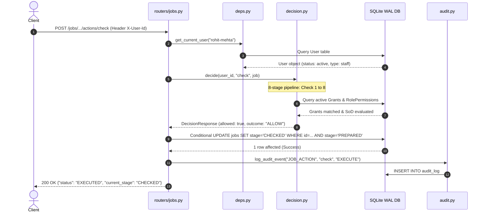

# Engineering Learning Guide: Nagarkot Access Control Service

This guide provides an architectural walkthrough, a code orientation directory, and 25 technical interview questions with model answers.

---

## 1. Request Lifecycle Walkthrough

To understand how requests flow through this service, trace an action request:
`POST /jobs/JOB-SHOWCASE-01/actions/check` with header `X-User-Id: rohit-mehta`



---

## 2. Codebase Navigation: Which File Answers Which Question?

| Question / Area of Concern | Primary File to Inspect | Secondary File |
| :--- | :--- | :--- |
| **How does the system decide who can do what?** | `app/decision.py` | `app/permissions.py` |
| **How are personal queues and visible jobs filtered at 200k scale?** | `app/scope.py` | `app/routers/me.py` |
| **Where are grants created, revoked, and auto-unassigned?** | `app/grants.py` | `app/routers/grants.py` |
| **How is the two-person rule for sensitive actions enforced?** | `app/approvals.py` | `app/routers/approvals.py` |
| **How is audit log immutability guaranteed?** | `app/db.py` (triggers) | `app/audit.py` |
| **Where are the core database entities and indexes defined?** | `app/models.py` | `app/schemas.py` |
| **How does time-travel and injectable clock work?** | `app/clock.py` | `tests/conftest.py` |
| **Where are the 20 test personas and showcase jobs seeded?** | `scripts/seed.py` | `scripts/describe_access.py` |
| **How is p95 < 200ms measured against 200,000 jobs?** | `scripts/benchmark.py` | `scripts/generate_scale.py` |

---

## 3. 25 Technical Interview Questions & Model Answers

### Architecture & Design
#### Q1: Why use an 8-stage sequential decision pipeline instead of an ad-hoc set of IF statements?
**Answer**: A structured pipeline guarantees deterministic precedence. An absent user or invalid job data must be rejected immediately, regardless of what grants exist. Evaluating all checks ensures that explanations and audit traces are complete rather than failing silently on the first condition.

#### Q2: Why are roles stored as data in tables rather than Python Enum classes?
**Answer**: Customs operations and compliance policies change frequently. Modeling roles and their permissions in relational tables (`roles`, `role_permissions`) allows authorized administrators to introduce new roles or reconfigure existing roles dynamically without requiring a code commit, PR review, container build, and service redeployment.

#### Q3: Why do RolePermissions have `added_at` and `removed_at` columns?
**Answer**: Temporal versioning. If an auditor asks, *"Who had permission to file this shipment on October 3rd?"*, querying today's role definitions would produce false historical answers if permissions were altered in November. Versioned timestamps enable exact historical reconstruction.

#### Q4: Why are grants never deleted from the database?
**Answer**: For compliance and non-repudiation. In customs brokerage, deleting a grant erases proof that an individual was authorized when they took an action. Grants are strictly append-only; revoking simply records `revoked_at` and `revoked_by`.

#### Q5: What is the purpose of the `batch_id` column on the grants table?
**Answer**: When an administrator grants a user access across several clients or branches, the request is expanded into multiple rows. Grouping them by `batch_id` provides atomic traceability back to the single administrative action that created them.

---

### Security, Separation of Duties & Approvals
#### Q6: How does the system prevent a user from approving their own checklist?
**Answer**: Through runtime Separation of Duties (SoD). In `app/decision.py`, check 7 evaluates `sod_rules`. For action `check`, it verifies `job.prepared_by != user.id`. If equal, it halts with `SOD_VIOLATION_MAKER_CHECKER`.

#### Q7: Why can't Ops Admin use `job.override` to bypass SoD or edit a FILED job?
**Answer**: Security boundaries are hierarchical. Operational overrides allow workflow corrections on unfiled jobs (e.g. rolling back from `PREPARED` to `CONFIRMED`), but the decision engine explicitly asserts that SoD rules and FILED protection rules cannot be overridden by administrative privilege.

#### Q8: How does the two-person approval workflow fail closed if someone tampers with the job?
**Answer**: In `app/approvals.py`, when an Approver calls `approve()`, the system re-validates the job's current stage. If the job was altered or cancelled concurrently, the approval request is immediately marked `stale` and aborted, preventing stale or hijacked authorizations.

#### Q9: What prevents an Access Admin with Mumbai branch scope from granting national access?
**Answer**: Scope containment verification in `app/grants.py`. A grantor can only create grants whose scope is equal to or narrower than their own `access.manage` grant. Wildcards (`NULL`) are rejected unless the grantor also holds a wildcard grant.

#### Q10: How does the system prevent the sole Super Admin from locking themselves out?
**Answer**: The lock-out guard in `revoke_grant()` counts active grants for role `super_admin`. If the count is $\le 1$, revocation is aborted with `LAST_SUPER_ADMIN_GUARD`.

---

### Database, Concurrency & Performance
#### Q11: How do you prevent race conditions when two checkers check the same job simultaneously?
**Answer**: Optimistic concurrency via conditional updates:
`UPDATE jobs SET stage='CHECKED', ... WHERE id=:id AND stage='PREPARED'`.
If another worker advanced the stage milliseconds earlier, `rowcount` returns 0, and the service returns HTTP 409 Conflict.

#### Q12: Why did we choose keyset pagination over `LIMIT / OFFSET`?
**Answer**: At 200,000 jobs, `OFFSET 150000` forces the database engine to scan and discard 150,000 index tuples, degrading query latency from milliseconds to seconds. Keyset pagination (`WHERE (updated_at, id) < (:cursor_dt, :cursor_id)`) leverages B-tree seeks in $O(\log N)$ time.

#### Q13: What SQLite WAL settings enable sub-30ms p95 latencies?
**Answer**: `PRAGMA journal_mode=WAL;` allows concurrent readers without blocking writers. `PRAGMA synchronous=NORMAL;` and `PRAGMA cache_size=-64000;` (64MB memory cache) ensure that index seeks operate in RAM.

#### Q14: How are SQLite append-only triggers implemented?
**Answer**:
```sql
CREATE TRIGGER audit_log_no_update BEFORE UPDATE ON audit_log
BEGIN SELECT RAISE(ABORT, 'Audit log is append-only: UPDATE prohibited'); END;
```
This guarantees database-level immutability even if application-level code contains vulnerabilities.

#### Q15: Why is there no in-memory decision caching in v1?
**Answer**: Caching introduces stale authorization windows where a revoked employee can still perform actions until TTL expires. With indexed SQL queries executing in 10–25ms, caching is unnecessary and introduces security risk.

---

### Compliance, Auditing & Explainability
#### Q16: Why are `/decide` and `/explain` read requests NOT written to the audit log?
**Answer**: `/decide` is an idempotent dry-run check used by UI components to show/hide action buttons. Logging every UI check would flood the audit log with millions of benign reads. The audit log records state transitions, administrative grants/roles, and denied mutating attempts.

#### Q17: What information is captured in a denied attempt audit log entry?
**Answer**: The actor ID, actor type, attempted action, target job ID, prospective state, timestamp, and the exact `reason_codes` explaining which of the 8 checks failed.

#### Q18: How does `GET /jobs/{id}/who-could` work?
**Answer**: It reconstructs user states, grants, and job attributes as of timestamp $T$, runs the decision engine against all directory users, and returns the set of authorized individuals alongside the actual actor from the audit log.

#### Q19: How does `explain_compare` synthesize a human explanation?
**Answer**: It evaluates both users through the decision engine, detects which checks diverged (e.g. User A matched grant `GRT-1` whereas User B failed check 6 with `NO_GRANT`), and formats a concise side-by-side summary.

#### Q20: How are client users prevented from inspecting other clients' shipments?
**Answer**: Through dual-layer enforcement:
1. Decision engine: `decide()` verifies `job.client_id == user.client_id`.
2. Scope compiler: `compile_jobs_view_predicate()` appends `Job.client_id == user.client_id` to all SQL queries.

---

### Edge Cases, Fail-Closed & Testing
#### Q21: What happens if an unhandled exception or database error occurs during a decision?
**Answer**: Fail-closed principle: The engine catches `Exception`, logs an error audit event, and returns `Decision(allowed=False, outcome="DENY", primary_reason="INDETERMINATE")`.

#### Q22: What happens to a staff member's assigned jobs when they are marked absent?
**Answer**: `update_user_status()` triggers `auto_unassign_ineligible_jobs()`. Any job assigned to that user that they can no longer act on is unassigned (`assigned_to = NULL`) and returned to the pool with an `AUTO_UNASSIGNED` audit record.

#### Q23: Can a staff member hold an expired cover grant and still act?
**Answer**: No. All grant queries filter on `valid_from <= now AND (valid_to IS NULL OR valid_to >= now)`. The second `valid_to` passes, the grant ceases to match.

#### Q24: How was queue equivalence verified between SQL and Python?
**Answer**: In `tests/test_queue_equivalence.py`, we iterate over every seeded user, calculate their expected actionable jobs in Python using `decide()`, and assert that the set of job IDs exactly matches the result of the SQL predicate compiled by `scope.py`.

#### Q25: Why does explicit DENY always win over ALLOW?
**Answer**: Deny-override ensures safety in complex decentralized organizations. If an employee has a general grant to check all shipments at Kolkata, but has a personal conflict of interest with client C04, a specific DENY grant for C04 ensures they can never act on C04 jobs, regardless of other broad grants.
